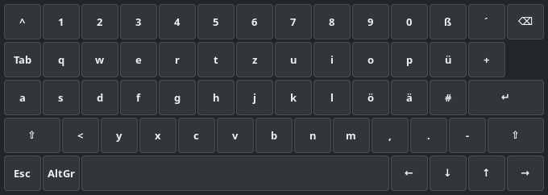
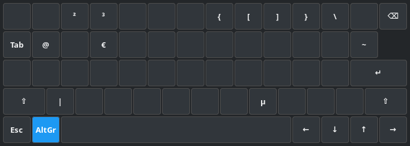
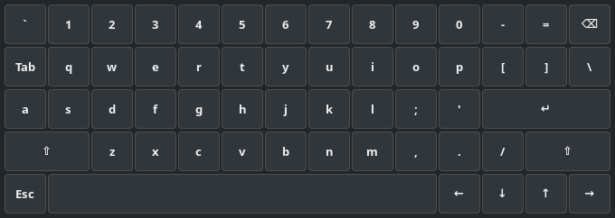

# wayland-osk

A small floating on-screen keyboard for Wayland desktops that you operate with the mouse.
A mouse button shows and hides it, and what you click is typed into whatever window has
the focus.



## Why this exists

My PC is connected to a projector, and I use it from the couch with nothing but a
wireless mouse. The keyboard stays on the desk. That works fine until a search field, a
login or a file name needs a few characters, and then I have to get up.

An on-screen keyboard is the obvious answer, but on GNOME with Wayland none of the ones I
tried did the job:

- **GNOME's own on-screen keyboard** is made for touch screens. With it switched on, it
  popped up on every click into a terminal, also while I was sitting at the desk with a
  real keyboard.
- **Keyboards for wlroots compositors** dock themselves to the screen edge with the
  layer-shell protocol. GNOME does not implement that protocol, so they do not start
  there.
- **A normal window with buttons** takes the keyboard focus when you click it. The
  application you wanted to type into loses the focus, and the text goes nowhere.

wayland-osk gets around this with two decisions:

- It is an **XWayland window that refuses the focus**. An X11 window can be told not to
  accept the keyboard focus; a native Wayland window cannot. So the application you are
  typing into keeps the focus while you click keys.
- It types through **ydotool**, a virtual keyboard at kernel level. To the system it
  looks like a second physical keyboard, so it works in every application: native
  Wayland, XWayland and Electron alike.

And it is shown and hidden with a **mouse button**, because the mouse is the only thing
in my hand.

## What it looks like

German layout (QWERTZ), plain and with AltGr held:




US layout (QWERTY):



Shift and AltGr are sticky for one key, like on a phone: click Shift, then the letter.

## Requirements

- A Wayland session with XWayland (GNOME, KDE Plasma and most others have it).
- Python 3 with PyGObject and GTK 3, and python-evdev.
- [ydotool](https://github.com/ReimuNotMoe/ydotool) with its daemon `ydotoold` running.
- For the mouse button: permission to read input devices, on most distributions
  membership in the group `input`.

On Arch Linux:

```
sudo pacman -S --needed ydotool python-evdev python-gobject gtk3
systemctl --user enable --now ydotool.service
```

`ydotoold` needs access to `/dev/uinput`. If the service does not start, check that your
user may open that device (also via the group `input` on Arch).

Developed and used on Arch Linux with GNOME on Wayland. Other desktops and distributions
should work, but have not been tried.

## Installation

There is nothing to build. Clone the repository and run the scripts from there:

```
git clone https://github.com/jantyka/wayland-osk ~/wayland-osk
cd ~/wayland-osk
./wayland-osk-toggle        # shows the keyboard; run it again to hide it
```

To use the mouse button, start the listener:

```
./wayland-osk-listener
```

and to have it start with your session:

```
cp systemd/wayland-osk-listener.service ~/.config/systemd/user/
systemctl --user enable --now wayland-osk-listener.service
```

The unit expects the repository in `~/wayland-osk`. Change the path in `ExecStart` if you
put it somewhere else.

## Configuration

Optional. Without a configuration file you get the German layout and the middle mouse
button.

```
mkdir -p ~/.config/wayland-osk
cp config.example.ini ~/.config/wayland-osk/config.ini
```

```ini
[keyboard]
layout = de          # de = German QWERTZ, us = US QWERTY

[trigger]
button = BTN_MIDDLE  # the mouse button that shows and hides the keyboard
device =             # optional: only mice whose name contains this text
```

**Finding the name of a mouse button:**

```
./wayland-osk-listener --detect
```

Press the button and its name is printed. `./wayland-osk-listener --list` shows the mice
that were found and the buttons they have. Common ones are `BTN_MIDDLE` (wheel click),
`BTN_SIDE` and `BTN_EXTRA` (thumb buttons).

The button keeps its normal function. If you pick the wheel click, a click still pastes
or opens a link in a new tab; a thumb button is often the better choice.

After changing the configuration, restart the listener
(`systemctl --user restart wayland-osk-listener.service`). The keyboard reads it every
time it is shown.

## Layouts

Each key on the screen sends the code of a *physical* key, the same thing a real keyboard
does. Which character comes out is decided by the keyboard layout of your system. The
`layout` setting only chooses the labels, so **it has to match your system layout**. With
a German system layout and `layout = us` the key labelled `z` would type `y`.

This is also why umlauts, `ß`, `@` and `€` work without any special handling: the German
layout puts `@` on AltGr+Q, so the keyboard sends AltGr+Q.

`^`, `´` and `` ` `` are dead keys in the German layout, as on a real keyboard: they
combine with the next letter.

To add a layout, add its labels to `LABELS` and its rows to `ROWS` in `wayland-osk`. The
numbers are Linux key codes; `sudo evtest` shows them for your keyboard.

## Other ways to open it

`wayland-osk-toggle` is an ordinary command. Instead of, or in addition to, the mouse
button you can bind it to a keyboard shortcut or a launcher in your desktop's settings.
`wayland-osk-toggle --layout us` overrides the configured layout once.

## Limitations

- No Ctrl, Alt or Super keys, no function keys, no Caps Lock. It is meant for typing a
  few words, not for working.
- The keyboard always appears at the bottom centre of the monitor it opens on and cannot
  be resized.
- It needs XWayland. On a session without it, the window does not appear.
- Only German and US layouts are included.

## A note on security

Both parts need powerful permissions, and that is inherent to how they work:

- Reading mouse buttons means reading input devices. A user in the group `input` can read
  every key that is pressed on the machine.
- `ydotoold` can inject any key press, and every program running as your user can ask it
  to.

That is the same trade-off as with any tool built on evdev and uinput. Do not set this up
on a machine where you do not trust the software running under your account.

## License

MIT, see [LICENSE](LICENSE).
